<p align="center"></p>

# Cairn

Un lecteur de flux pour ta veille quotidienne.

Rassemble tes sources, parcours les nouveautés et garde les pierres qui méritent de rester,
un cairn à la fois.

## Prérequis

- macOS 27 ou plus récent (Xcode 27)
- Xcode (premier lancement effectué : `sudo xcodebuild -runFirstLaunch`)
- [XcodeGen](https://github.com/yonaskolb/XcodeGen) : `brew install xcodegen`

## Structure

- `CairnCore/` : package Swift avec toute la logique (modèles SwiftData, lecture des flux, OPML, rétention, recherche) et ses tests.
- `App/` : l'application SwiftUI pour Mac (vues et commandes uniquement).
- `project.yml` : description du projet Xcode. `Cairn.xcodeproj` est généré et n'est pas versionné.

## Commandes

```sh
# Tests de la logique (le flag évite que SwiftPM réécrive Package.resolved sans Sparkle)
cd CairnCore && swift test --only-use-versions-from-resolved-file && cd ..

# Générer le projet Xcode puis construire l'app
xcodegen
xcodebuild -scheme Cairn -destination 'platform=macOS' -derivedDataPath build build

# Lancer l'app
open "build/Build/Products/Debug/Cairn Dev.app"
```

Pour développer dans Xcode : `xcodegen && open Cairn.xcodeproj`.

La version Debug s'appelle « Cairn Dev » (icône orange) : c'est une app distincte de la version installée, avec sa
propre bibliothèque et ses propres réglages, et les deux peuvent tourner en même temps. Pour y retrouver tes abonnements,
exporte-les en OPML depuis Cairn et importe-les dans Cairn Dev.

Les données sont stockées localement dans
`~/Library/Application Support/dev.cairn.Cairn/default.store`
(`dev.cairn.Cairn.debug` pour Cairn Dev).

Les versions précédentes de Cairn (avec App Sandbox) les gardaient dans
`~/Library/Containers/dev.cairn.Cairn/Data/`. Au premier lancement, Cairn les recopie (articles, réglages) sans toucher
à ce dossier : tu peux le supprimer une fois que tout est en place.

## Installation

Télécharge le `.dmg` depuis les [Releases](https://github.com/guillaume5th/cairn/releases) et glisse Cairn dans Applications.
L'app n'est pas notarisée par Apple : au premier lancement, macOS la bloque. Débloque-la avec

```sh
xattr -dr com.apple.quarantine /Applications/Cairn.app
```

Ensuite, Cairn se met à jour tout seul : il vérifie chaque jour si une nouvelle version est publiée (avec
[Sparkle](https://sparkle-project.org)), et « Rechercher les mises à jour… » dans le menu Cairn le fait aussitôt.

## Publier une version

Les commits suivent les [Conventional Commits](https://www.conventionalcommits.org/) (`feat:`, `fix:`, `feat!:`).
À chaque push sur `main`, release-please ouvre ou met à jour une PR de release (version + `CHANGELOG.md`).
La merger crée le tag `vX.Y.Z` et la GitHub Release. Ensuite, en local :

```sh
git pull && git checkout vX.Y.Z && scripts/release.sh   # build Release, DMG, attaché à la release
```

Le script attache aussi `appcast.xml` à la release : c'est le fichier que lit Sparkle pour proposer la mise à jour. Le DMG y est signé avec la
clé EdDSA rangée dans le trousseau du Mac qui publie : sans cette clé, les apps installées refusent toute mise à jour.
Garde-en une copie à l'abri (`generate_keys -x <fichier>`, outil fourni avec Sparkle).

## Abonnements

« Ajouter un abonnement » (⌘N) accepte l'adresse d'un flux ou simplement celle d'un site (`exemple.com` suffit) : Cairn
cherche les flux que la page déclare, puis les emplacements usuels (`/feed`, `/rss`, `/atom.xml`…). S'il en trouve plusieurs
(articles, commentaires, podcast…), il te laisse choisir. L'import et l'export OPML sont dans le menu Fichier.

## Article complet

Quand un flux ne donne qu'un extrait, le bouton « Article complet » de la barre de l'article télécharge sa page et en garde
le texte principal (sans menus, publicités ni commentaires), avec l'extracteur du mode Lecture de Firefox
([Readability.js](https://github.com/mozilla/readability), Apache 2.0). Le texte est gardé avec l'article ; le même bouton
revient au contenu du flux. Dans le menu d'un abonnement, « Toujours charger les articles complets » le fait pour chaque nouvel
article. Le site de l'article est contacté comme par un navigateur, mais sans cookies, et aucun de ses scripts n'est exécuté.
Les résumés IA portent sur l'article complet quand il est chargé.

## Résumé quotidien

Chaque jour à l'heure réglée (8 h par défaut), pendant que l'app est ouverte, Cairn rafraîchit les abonnements et fait résumer par une IA locale les articles publiés dans les 24 heures précédentes. Si l'app était fermée à cette heure-là, le résumé est fait au lancement suivant. Les résumés apparaissent dans l'entrée « Résumés quotidiens » de la barre latérale et sont gardés 7 jours par défaut. « Présentation > Générer le résumé maintenant » relance à la main. Avec « Me prévenir quand le résumé est prêt » (Réglages),
une notification annonce le résumé fait pendant que Cairn n'est pas au premier plan ; la toucher ouvre ce résumé.

Réglages (⌘,) : heure, durée de conservation (1 à 90 jours) et moteur :

- **Apple** (par défaut) : le modèle intégré au Mac, qui demande Apple Intelligence activé.
- **Ollama** : un serveur local (`http://localhost:11434` par défaut). Le modèle se choisit dans la liste des modèles installés sur ce serveur ; installe-en un avec `ollama pull <modèle>`, puis actualise la liste.

Le modèle d'Apple lit environ 4 000 tokens : les jours chargés, seuls les premiers articles ont un extrait, les suivants n'apportent que leur titre.

## Dépendances

Dependabot (`.github/dependabot.yml`) vérifie chaque semaine les paquets Swift de `CairnCore` et ouvre une pull request à chaque nouvelle version. Avant de fusionner : `cd CairnCore && swift test --only-use-versions-from-resolved-file`, puis construire l'app.
